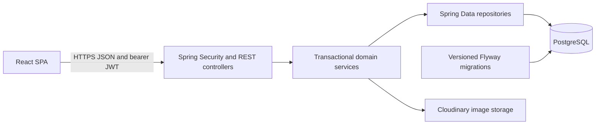

# KasiCircle architecture

KasiCircle is a React SPA backed by a Java 21 / Spring Boot API and PostgreSQL. Cloudinary stores business image binaries; PostgreSQL stores their metadata. The frontend routes public business, worker and job discovery alongside authenticated account, application, conversation and notification screens. Administrator routes are an additional UI convenience; backend permissions remain authoritative.

## Modules and boundaries

Backend source root: `backend/src/main/java/com/kasicircle/backend`.

| Module | Persistence and responsibility | Frontend entry points |
|---|---|---|
| auth/users | Registration, BCrypt passwords, login JWT, account profile/password; USER/ADMIN roles, RESIDENT/WORKER/BUSINESS account types | Register, Login, Profile, AuthContext |
| businesses | One business per owner, directory filters, image metadata/storage, author reviews and computed ratings | Explore, BusinessProfile, BusinessDetail, BusinessReviews |
| workers | One profile per WORKER owner; skill/category collections and public search | WorkerProfile, Workers, WorkerDetail |
| jobs | Employer-owned job lifecycle and applicant-owned applications; unique job/applicant pair | Jobs, JobForm, JobDetail, MyJobApplications |
| messaging | Persisted one-to-one participant pairs and messages | Messages; worker/job contact entry points |
| notifications | Recipient-owned persistent activity notifications with read timestamp | Notifications |
| moderation | Reports for business, worker, job and review targets; admin queue and resolution notes | ReportForm, AdminReports |
| shared/config | Error DTOs, JWT filter, security policy, CORS, storage configuration | API client error/session handling |

Controllers validate input DTOs and delegate to transactional services. Services derive the current account from Spring Security and check ownership or participation before accessing private data. Response DTOs avoid serializing JPA entities or account credentials. Public business contacts are intentional listing data; worker/job public DTOs omit personal email/phone. Applications are visible only to their applicant and owning employer. Messages require membership; notifications are selected by recipient, including mark-read mutations. Moderation queue/decision endpoints use backend `@PreAuthorize("hasRole('ADMIN')")`.

## Data and transaction behavior

Flyway V1–V11 creates users, businesses/images/reviews, worker profiles/skills/categories, jobs/applications, conversations/messages, notifications and reports. Hibernate validates the migrated schema at application startup. Reviews aggregate their current persisted ratings for summary/detail/listing responses; there is no stale stored rating counter to synchronize.

Application submission/status decisions and message sending create notifications inside their service transactions. Failure rolls back the business operation and notification together. Message history and public directories use paginated API responses. The frontend loads older messages explicitly and refreshes conversations on user action; there is no websocket transport or background delivery guarantee.

Conversation participant order is canonicalized by the service and the pair is unique. Review, worker owner and application uniqueness also have database constraints. Existing service checks give normal sequential duplicate attempts useful errors; concurrent duplicate requests can still race into constraint errors. See known limitations.

## Frontend integration

`frontend/src/services/api.js` is the shared fetch client. `VITE_API_BASE_URL` is embedded at build time. AuthContext persists the bearer token and user cache in localStorage, verifies cached sessions through `/api/users/me`, and responds to authenticated 401 events by clearing the session. Browser access control does not replace API checks.

React Router provides public discovery routes and protected personal/admin routes. Tailwind and shared components provide responsive layouts, labels, focus styling and loading/error/empty states. Component tests mock API boundaries; Playwright journeys exercise the real browser, JWT filter, services and migrated PostgreSQL together.

## Operational boundaries

The API is stateless apart from database/storage state. There is no queue, external notification delivery, public registration of administrators, or automatic deployment. Production infrastructure supplies HTTPS, secrets, database backups and monitoring. See [deployment](DEPLOYMENT.md), [QA](QA.md), [limitations](KNOWN_LIMITATIONS.md), and [API reference](../API_DOCUMENTATION.md).
